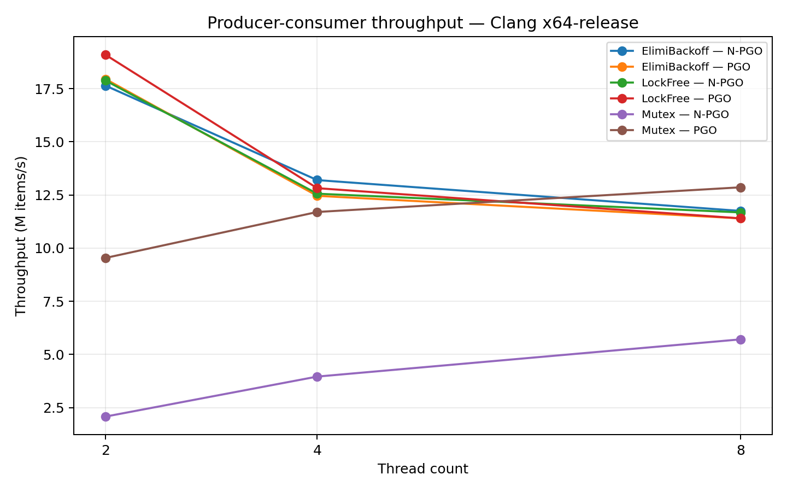
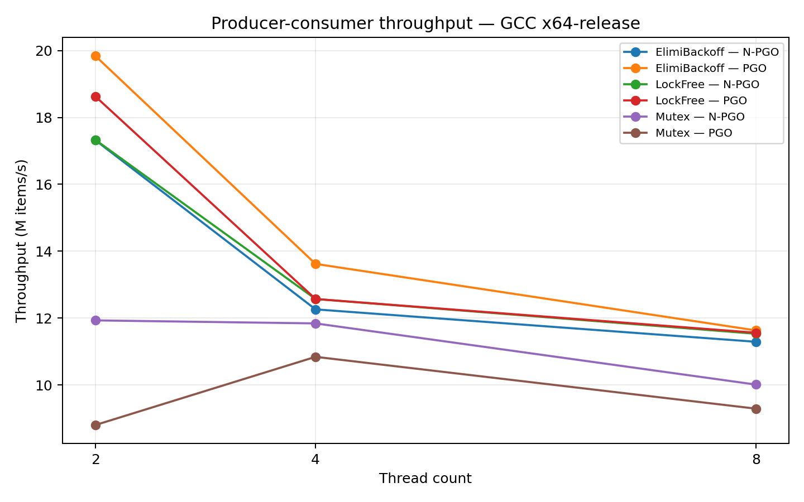
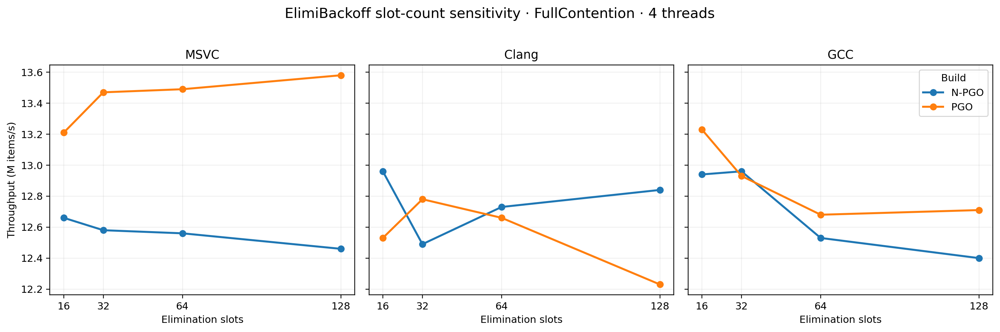
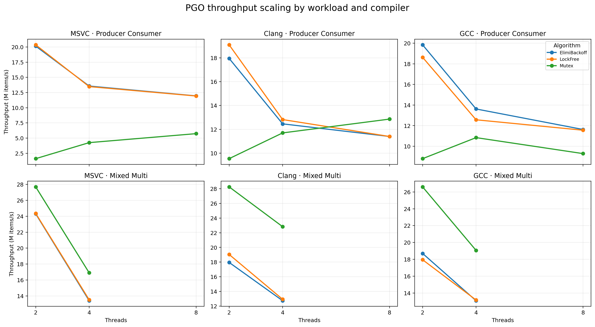
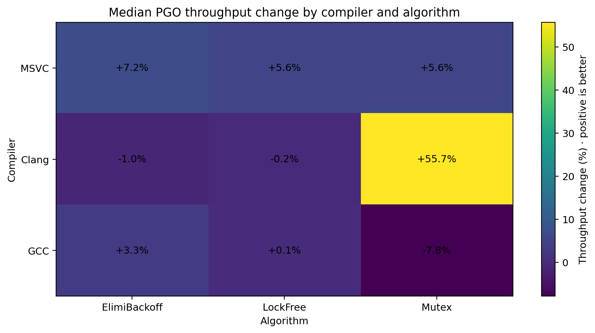

# Brief

This a pure C++ 20 implementation for serval concurrent containers: forward list, queue and stack with different approaches, for personal study

## Benchmakr

### Producer-Consumer

  
  
  

  

### ElimiBackoffStack

  

### PGO

  

  

# TODO

## Core

- [x] Concurrent stack
- [ ] Concurrent forward list
- [ ] Concurrent queue
- [ ] Add module functionality for GNU GCC and Clang complier
- [x] Compatibility with different compliers:
  - [x] UCRT Clang
  - [x] MSVC
  - [x] UCRT GCC
- [x] Compatibility with different build systems:CMake, Meson, Bazel
- [x] Compatibility with IDEs:
  - [ ] Visual Studio(temporarily MSVC x86/x64-debug/release configures only)
  - [x] Clion
- [x] Smoke tests(google/googletest)
- [x] Benchmark(google/benchmark)
- [x] Increment Build Cache:
  - [x] ccache
  - [x] sccache
- [x] PGO support for(CMake only)
  - [x] Clang
  - [x] GCC
  - [x] MSVC
- [ ] no-ninja generator support?(Maybe for Visual Studio Generator)

## Other

- [x] CI/CD
- [ ] More descriptions
  
## Temporay
- [ ] bazel and meson need updated to match CMake

